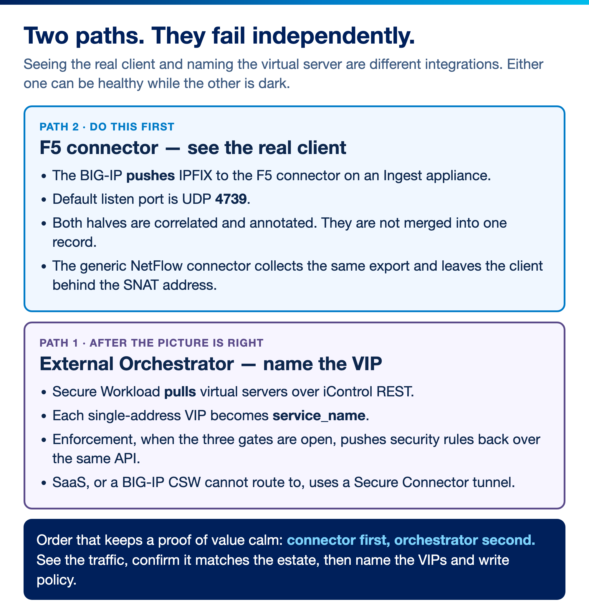
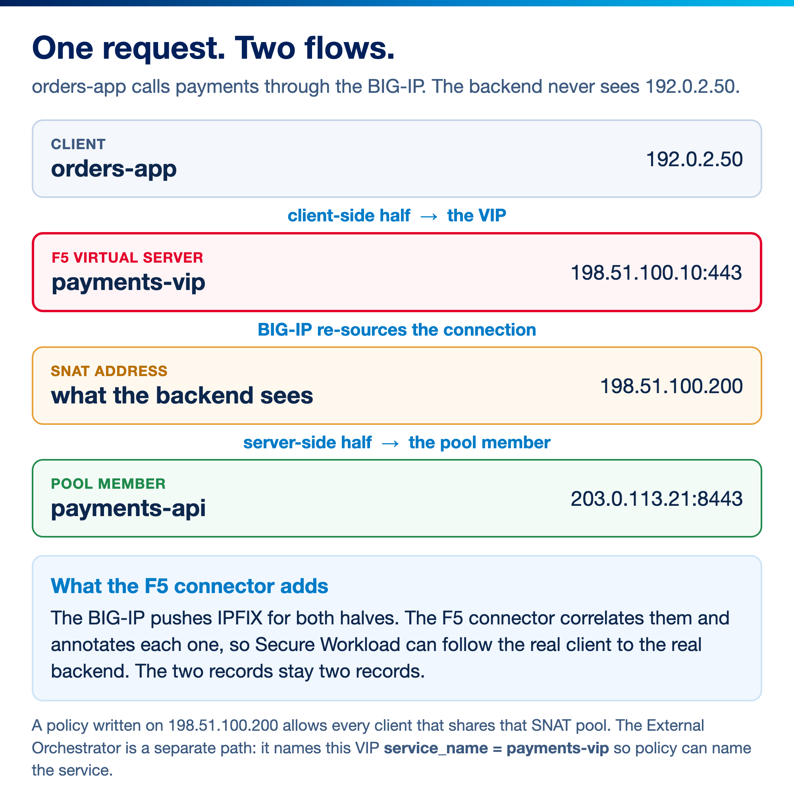
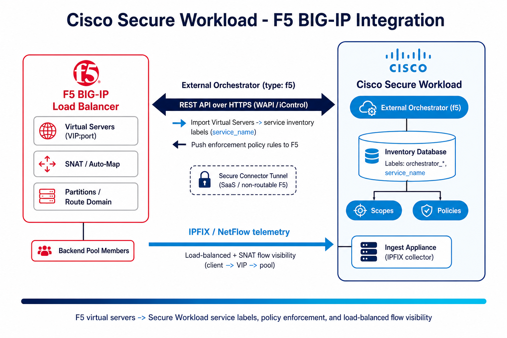
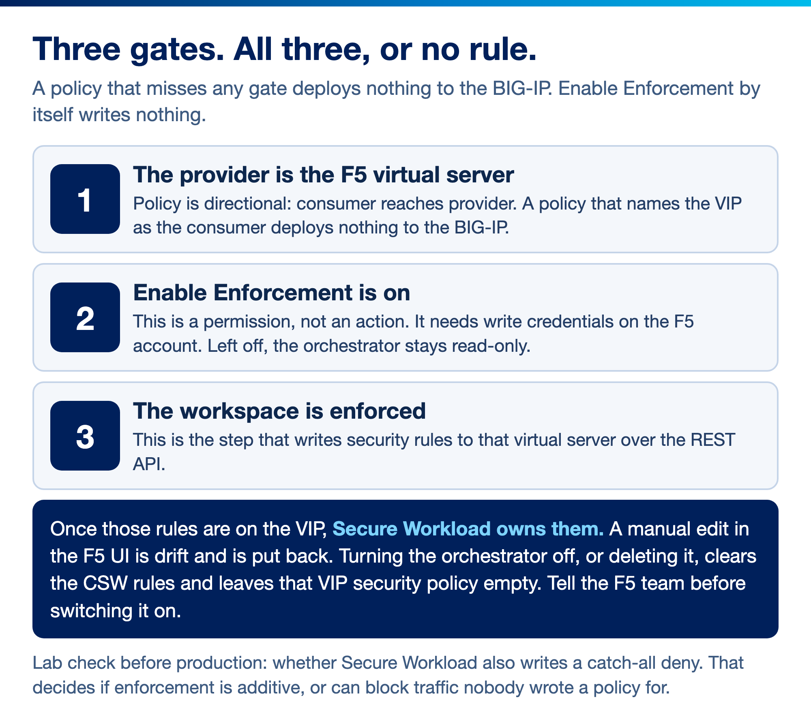
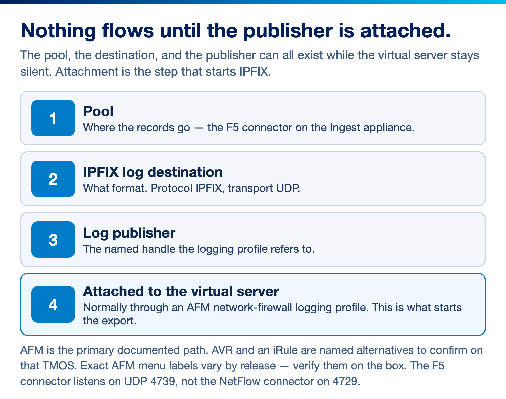

# Cisco Secure Workload → F5 BIG-IP Integration Guide

A step-by-step, **beginner-friendly** guide to integrating **F5 BIG-IP** with **Cisco Secure Workload (CSW)**. It covers the two ways CSW and F5 work together:

1. **External Orchestrator (`type: f5`)** — CSW imports F5 **virtual servers** as *service inventory* (labels), and can **push enforcement policy** back to the BIG-IP as security rules.
2. **Flow telemetry (IPFIX)** — the BIG-IP streams **IPFIX** to the **F5 connector** on a CSW **ingest appliance**, which **correlates both halves and annotates them** so CSW can follow the real client behind SNAT. The two records stay two records.

> **⚠ Disclaimer:** This is a **community reference guide** prepared by Cisco Solutions Engineering — not an official Cisco product document. Always refer to the [official Cisco Secure Workload documentation](https://www.cisco.com/c/en/us/support/security/tetration/series.html) and the [Compatibility Matrix](https://www.cisco.com/c/m/en_us/products/security/secure-workload-compatibility-matrix.html) for authoritative, up-to-date guidance.

---

## 0. New to CSW or F5? Read this first (2 minutes)

If you've never touched either product, here's the mental model:

- **Cisco Secure Workload (CSW)** discovers how applications talk to each other and builds **least-privilege micro-segmentation** policy. It groups workloads using **labels** → **scopes** → **policies**.
- **F5 BIG-IP** is a **load balancer / ADC**. Clients connect to a **Virtual Server** (a **VIP** = virtual IP + port); the BIG-IP forwards to a **pool** of backend servers. It often rewrites the source IP using **SNAT** (Secure NAT) or **Auto-Map**.

**Why integrate them?** Two problems F5 creates for segmentation, and how CSW solves them:

| Problem F5 introduces | What the integration gives you |
|---|---|
| The load balancer is a "black box" — CSW doesn't know which VIPs map to which services | **External Orchestrator** imports each virtual server as a labeled **service inventory** item (`service_name`, `orchestrator_*`) |
| SNAT hides the real client IP, so backend flows all look like they come from the F5 | The **F5 connector** ingests IPFIX for both halves, **correlates them, and annotates each one**, so the client-to-backend path can be followed |
| You want the load balancer to enforce your segmentation policy | **Policy enforcement** translates CSW policies into F5 security rules and deploys them via the REST API |

**Which path do you need?**



*Two independent paths. Pick by what you need; most mature deployments run both.*

- Want **labels + policy enforcement at the F5**? → Do the **External Orchestrator** (§4–§7).
- Want **flow visibility** of load-balanced traffic? → Do **IPFIX telemetry** (§8).
- Most mature deployments do **both**.

---

## 0.5 How it actually works — a worked example

If you read nothing else, read this. Everything in §4–§8 is the configuration that makes the picture below true.

### The problem, in one sentence

**A load balancer breaks one conversation into two, and a segmentation product that only sees one half cannot write a policy about it.**

### Set the scene

Example addresses only — these are documentation ranges, not real.

| Thing | Address | What it is |
|---|---|---|
| `orders-app` | `192.0.2.50` | A VM that wants to call the payments service |
| `payments-vip` | `198.51.100.10:443` | The virtual server on the BIG-IP |
| SNAT address | `198.51.100.200` | What the BIG-IP rewrites the source to |
| `payments-api` | `203.0.113.21:8443` | A pool member behind the VIP |

### What CSW sees *without* the integration

`orders-app` makes one request. The BIG-IP forwards it to a pool member as a **separate, re-sourced connection**, rewriting the source to the SNAT address. CSW now has two flows that look unrelated:

```
flow 1:   192.0.2.50      →  198.51.100.10:443     seen by the agent on orders-app
flow 2:   198.51.100.200  →  203.0.113.21:8443     seen by the agent on payments-api
```

Nothing connects them. From the backend's point of view **every** client in the estate is `198.51.100.200`. You cannot write "orders-app may talk to payments-api", because as far as the data shows, it never does.

This is also why a policy built on the SNAT address is dangerous rather than merely imprecise: if many applications share a SNAT pool, allowing that address allows **all of them**.

### What the two integration paths each fix

**The External Orchestrator fixes "what is that VIP?"** CSW connects to the BIG-IP over the REST API, reads the list of virtual servers, and turns each one into a labelled inventory item. `198.51.100.10:443` stops being an anonymous address and becomes `service_name = payments-vip`, something you can name in a scope or a policy.

**The F5 connector fixes "who was the real client?"** The BIG-IP exports IPFIX records describing **both** halves. The connector correlates them — this is the **NAT stitching** — and annotates both, so the path from the real client through the VIP to the pool member can be followed instead of dead-ending at the SNAT address.



*The BIG-IP re-sources the connection. The F5 connector correlates both halves so the client-to-backend path survives the SNAT.*

### Why they are separate, and which you need

They are **independent**. Neither requires the other, and they fail independently.

| If you only do… | You get | You still cannot |
|---|---|---|
| **Orchestrator** | VIP names as labels; optional enforcement at the F5 | See who the real client was |
| **F5 connector** | The stitched client-to-backend path | Refer to the VIP by name, or enforce at the F5 |
| **Both** | Named services *and* real client visibility | — |

**A sensible order is connector first, orchestrator second** — visibility before enforcement. See the traffic, confirm the picture matches what you believe is happening, then name things and write policy. Most mature deployments end up running both.

### Three things to be clear-eyed about

1. **This is L3/L4.** You get the real client, the backend, ports and protocol. You do **not** get L7. If one VIP on port 443 fronts several applications separated by **URL or URI**, nothing here will tell them apart.
2. **Stitching quality depends on what the BIG-IP exports.** The correlation is driven by IPFIX records, not by CSW reading a live table on the F5. The IPFIX template and fields are a real prerequisite — see §11.
3. **Enforcement at the F5 makes CSW the owner** of that virtual server's security rules, and turning it off removes them. Read §7 before enabling it.

---

## 1. Architecture



*Two independent data paths, travelling in opposite directions. **Top:** CSW **pulls** — the External Orchestrator uses the F5 REST API (HTTPS) to import virtual servers as service-inventory labels and to push enforcement rules back to the BIG-IP. **Bottom:** the BIG-IP **pushes** — it exports IPFIX to the F5 connector on a CSW ingest appliance, which stitches the NATed flows.*

| Path | Direction | Transport | Purpose |
|---|---|---|---|
| **External Orchestrator** | CSW ⇄ F5 | HTTPS REST API (iControl) | Import virtual servers → labels; push policy rules to F5 |
| **Flow telemetry** | F5 → CSW ingest appliance | IPFIX (UDP) | **F5 connector** correlates both halves and annotates them. The records stay two records |

---

## 2. What you get

**Service inventory & labels** (from the orchestrator): each F5 virtual server becomes a searchable inventory item with system labels:

| Key | Value |
|---|---|
| `orchestrator_system/orch_type` | `f5` |
| `orchestrator_system/workload_type` | `service` |
| `orchestrator_system/service_name` | *(virtual server name)* |
| `orchestrator_system/namespace` | *(partition)* |
| `orchestrator_system/cluster_id` / `cluster_name` | *(orchestrator identity)* |
| `orchestrator_annotation/snat_address` | *(SNAT address of the virtual server)* |

Use these in **inventory search**, **scopes**, and **policies** — for example, segment everything behind a given VIP.

**Policy enforcement** (optional): CSW translates logical policies whose **provider** matches an F5 virtual server into **F5 security policy rules** and deploys them to the BIG-IP. CSW becomes the source of truth for those rules.

**Flow visibility** (from IPFIX): CSW ingests BIG-IP flow records so the load-balanced path is visible in ADM (Application Dependency Mapping) and the flow explorer.

---

## 3. Prerequisites

**Gather these before you open either UI.** Most failed first attempts are a missing one of these, not a wrong click.

| # | What you need | Who usually owns it |
|---|---|---|
| 1 | F5 **management IP or FQDN**, and for an HA pair the **standby** node | Network / F5 team |
| 2 | A **service account** on the BIG-IP, and a decision on read-only vs read+write (§3.1) | F5 team |
| 3 | The **partitions** in scope and their **route domain** (default `0`) | F5 team |
| 4 | Whether the BIG-IP presents a **CA-signed or self-signed** certificate | F5 team |
| 5 | Whether CSW can **reach the F5 REST endpoint** directly, or needs a Secure Connector (§4.1) | Network team |
| 6 | For IPFIX: the **ingest appliance collector IP and UDP port**, and firewall approval from the F5 self-IP | CSW + network teams |

### F5 BIG-IP side
- BIG-IP with a reachable **iControl REST API** endpoint (HTTPS/443). Documented baseline: **v12.1.1+** (use a current, supported TMOS release).
- A BIG-IP account for CSW:
  - **Read-only** is enough for **label import only**.
  - **Read + write** is required if you enable **policy enforcement** (CSW writes security rules).
- Know your **partitions** and **route domain** (default `0`) — these decide which virtual servers get imported.
- For IPFIX (§8): a module that can **export IPFIX** — normally **AFM** (Advanced Firewall Manager) — plus the ability to define an IPFIX **log destination** and **log publisher**. Confirm what is licensed on your platform (§8.2).

### Cisco Secure Workload side
- CSW **4.x** (on-prem or SaaS). Orchestrators live under **Manage → External Orchestrators**.
- For IPFIX: a deployed **Ingest virtual appliance** with an **F5 connector** (8 vCPU / 8 GB / 250 GB per the Compatibility Matrix). **Use the F5 connector, not the generic NetFlow/IPFIX connector** — only the F5 connector does NAT stitching (§8.1).
- A user with **Site Admin / Root Scope Owner** rights, or an API key with the `external_integration` capability for the API path (§9).
- For **SaaS / non-routable F5**: a healthy **Secure Connector** tunnel (§4.1).

### Network / firewall
- **HTTPS (TCP/443)** from the CSW source (cluster / SaaS egress / Secure Connector VM) **→ F5 management/REST endpoint**.
- **IPFIX (UDP, your chosen port, e.g. 4739)** from the **F5 self-IP** **→ CSW ingest appliance collector IP**.

### 3.1 Create a least-privilege F5 service account (recommended)

1. On the BIG-IP: **System → Users → User List → Create**.
2. Create a dedicated user (e.g. `svc-csw`).
3. Role:
   - **Label import only:** assign a **read-only** role (e.g. *Guest* / *Operator* scoped to the relevant partitions).
   - **Policy enforcement:** assign a role with **write** to security/AFM objects on the relevant partitions (e.g. *Administrator* or a scoped custom role) — CSW must create/replace rules.
4. Give it access to the partitions in scope.

> **Security:** Store this credential in your secrets manager. Never commit it to source control. CSW stores it encrypted; you must **re-enter the password every time you edit** the orchestrator.

---

## 4. Configure the F5 External Orchestrator (UI)

**Path:** `Manage → External Orchestrators → Create New Configuration`

### Step 1 — Basic tab

Select **Type = F5 BIG-IP**, then fill the common fields:

| Field | Required | Value / guidance |
|---|---|---|
| **Name** | ✅ | Unique per tenant, e.g. `f5-bigip-dc1` |
| **Type** | ✅ | `F5 BIG-IP` (not editable after creation) |
| **Description** | ❌ | e.g. "DC1 BIG-IP — virtual-server labels + enforcement" |
| **Username** | ✅ | The F5 service account (e.g. `svc-csw`) |
| **Password** | ✅ | The service account password (re-enter on every edit) |
| **Full Snapshot Interval (s)** | ✅ | How often to re-poll F5. Default works for most; first snapshot may take ~60s |
| **Delta Interval (s)** | ❌ | Incremental poll (default 60s). First full snapshot completes in ~60s |
| **Accept Self-signed Cert** | ❌ | Check only if the BIG-IP presents a self-signed cert (lab). Prefer a CA-signed cert in production |
| **Secure Connector Tunnel** | ❌ | Check for **SaaS / non-routable** F5 (see §4.1) |

### Step 2 — Hosts List tab

Add the F5 REST API endpoint:

| Column | Value |
|---|---|
| **Host Name / IP** | F5 management IP or FQDN |
| **Port** | `443` |

- For an **HA pair**, enter the **standby node** so the orchestrator **fails over** to the currently-active node.
- A **different BIG-IP** requires a **separate orchestrator**.

### Step 3 — F5-specific fields

| Field | Default | What it does |
|---|---|---|
| **Route Domain** | `0` | Only virtual servers in partitions assigned to this route domain are imported |
| **Enable Enforcement** | Off | If checked, CSW may deploy security rules to this BIG-IP (**requires write credentials**). Start **off** — turn on later (§7) |

### Step 4 — (Optional) Alerts tab
- Check **Alert enabled**; set **Severity** and **Disconnect Duration (m)**.
- Also enable **Connector Alerts** under **Manage → Workloads → Alert Configs**.

### Step 5 — Create

Click **Create**.

**What should happen:** the connection status updates within about a minute, and the first full snapshot of virtual servers typically completes in **~60 seconds**. After that first snapshot, CSW keeps the picture current **incrementally** on the delta interval rather than re-reading everything.

**Nothing is pushed to the BIG-IP at this point.** With **Enable Enforcement** off, this is a read-only operation — CSW is reading the virtual-server list and nothing more. That is why it is safe to create the orchestrator in a production tenant before you have decided anything about enforcement.

**If the status is not healthy,** the error text names the cause. The three common ones are credentials, reachability, and certificate — see §11.

### 4.1 (SaaS only) Secure Connector tunnel

Skip if CSW is **on-prem** and can reach the F5 directly. For **SaaS/TaaS** or a non-routable F5:

1. In CSW: **Manage → Secure Connector** → download/register the client on a Linux VM that **can** reach the F5.
2. Size per the [Compatibility Matrix](https://www.cisco.com/c/m/en_us/products/security/secure-workload-compatibility-matrix.html) (2 vCPU / 4 GB RAM; RHEL/Rocky/Alma).
3. Confirm the Secure Connector is **Active/Connected**, then check **Secure Connector Tunnel** on the orchestrator.

---

## 5. Verify label import

### 5.1 Connection status

Open the orchestrator row — the status should be healthy. If it isn't, read the error, which names the cause: bad credentials, unreachable host, or a certificate problem.

**Healthy status only proves CSW can talk to the BIG-IP.** It does not prove anything was imported. Do §5.2 as well — an orchestrator can be perfectly connected and import zero virtual servers, usually because of the route domain or the single-address caveat below.

### 5.2 Find your F5 services in inventory
**Path:** `Investigate → Inventory Search`

```
orchestrator_system/orch_type = f5
```

```
orchestrator_system/workload_type = service and orchestrator_system/service_name = my-vip
```

Each virtual server appears as a **service inventory** item characterized by its **VIP + protocol + port**, with `service_name` and `orchestrator_*` labels.

**What success looks like:** the first query returns one item per virtual server in scope. Compare that count against the virtual-server list on the BIG-IP itself — if CSW shows fewer, the gap is almost always the route domain or the caveat below.



*A healthy orchestrator proves connectivity, not import. Check the inventory count as well.*

> **Caveat:** Only a VIP given as a **single address** is supported — a VIP defined as a subnet is **not** imported.

---

## 6. Use F5 labels in scopes & policies

1. **Manage → Scopes and Inventory** → create/edit a scope using an F5 label query, e.g. `orchestrator_system/service_name = web-vip`.
2. Build workspace policies where the **provider** is the F5 service.
3. Discover and analyze policy as usual — the F5 service behaves like any other CSW inventory.

---

## 7. (Optional) Enable policy enforcement to F5

> Only do this once you understand the impact: **CSW becomes the owner** of the virtual server's security rules.

### 7.1 How enforcement actually works

**Three things must line up before a single rule reaches the BIG-IP.** Most confusion about this feature comes from only knowing about one or two of them.



*Three gates. A policy that fails any of them produces nothing on the BIG-IP.*

#### Gate 1 — the policy must name the F5 service as the *provider*

CSW policies are **directional**. Every policy says: a **consumer** may reach a **provider**, on a given port and protocol. The provider is the side offering the service.

**Only policies where the provider is a labelled F5 virtual server are rendered to the F5.** This follows from what a load balancer is — the VIP is a service that clients consume, so protecting it means controlling who may reach it. A policy in which the F5 service is the *consumer* produces nothing on the BIG-IP.

That is also why §4–§6 come first. Until the orchestrator has imported the virtual server and given it a `service_name`, there is nothing to name as a provider.

#### Gate 2 — the orchestrator must permit it

**Enable Enforcement** on the orchestrator is a **permission, not an action.** Switching it on deploys nothing. It tells CSW that this BIG-IP is allowed to receive rules, and it requires **write** credentials.

#### Gate 3 — the workspace must be enforced

Rules are only written when you **Enforce** the workspace holding the policy. This is the normal CSW policy lifecycle, unchanged by the F5 being involved — you can discover and analyse policy for an F5-provider service first, and see the effect before anything is deployed.

**Two switches, both required.** The orchestrator toggle is set once by whoever owns the integration. The workspace enforcement is driven by whoever owns the application. Neither alone changes the BIG-IP.

### 7.2 What CSW owns once it is on

| CSW does | CSW does not |
|---|---|
| Write security rules to the virtual servers named as providers | Touch virtual servers that are not referenced by an enforced policy |
| Replace the VIP's **security-policy assignment** with a CSW-managed one | Delete your existing policies from the BIG-IP's policy list — only the *assignment* to that VIP is swapped |
| Revert manual rule changes on a managed VIP as **drift** | Manage anything other than those security rules — pools, profiles, iRules and the rest are untouched |

**The practical consequence:** for any VIP under enforcement, **CSW is the source of truth and the F5 UI is read-only.** Someone editing rules there will see their change disappear. Tell the F5 team before switching this on, not afterwards.



*Enabling enforcement deploys nothing by itself. Note what happens when it is later turned off.*

**Before you enable it, be able to answer these:**

| Question | Why it matters |
|---|---|
| What security policy is assigned to this virtual server **today**? | CSW replaces that assignment. Record it first — that record is your rollback. |
| Does anyone change rules on this VIP **outside** CSW? | Drift is reverted. Those people need telling before, not after. |
| Who is expected to remove the orchestrator, and do they know what happens? | Disabling or deleting it clears the CSW rules and leaves the VIP's security policy empty. |
| Do the credentials actually have **write** access? | Read-only credentials fail at deploy time, not at enable time. |

**Steps:**
1. Edit the orchestrator → check **Enable Enforcement** (credentials must have **write** access). This alone deploys nothing yet.
2. In the **workspace** that contains at least one policy whose provider is the F5 service, run **Enforce**.
3. Verify on the BIG-IP that the virtual server now has CSW-generated allow/drop rules. Use the OpenAPI *policy enforcement status for external orchestrator* to confirm success/failure.

> **Stopping enforcement:** Disabling enforcement on the orchestrator (or deleting it) **immediately removes all CSW rules** from the BIG-IP, leaving the virtual server's security policy **empty**. Plan for this.

### 7.3 Prove this in a lab before production

**This guide does not state whether CSW writes a catch-all deny at the end of the rule list it generates.** That single question decides whether enabling enforcement on a VIP is purely additive or can start blocking traffic you never wrote a policy for. **Determine it on a non-production virtual server first** — do not infer it.

While you are there, establish the rest of the blast radius for your release:

| Confirm | Why you need to know |
|---|---|
| **Is there a default deny?** Does traffic with no matching policy still pass? | Decides whether this is additive or blocking |
| What the generated rules **actually look like** on the BIG-IP | So the F5 team can recognise and audit them |
| Whether **both directions** are rendered, or only inbound to the VIP | Affects what the policy really covers |
| What happens to **in-flight connections** at the moment rules are deployed | Decides whether this needs a change window |
| How enforcement interacts with **agent enforcement on the pool members**, if those hosts also run CSW agents | Traffic may be evaluated twice, in two places, against two renderings of the same intent |
| How long **removal** takes, and what the VIP looks like immediately afterwards | This is your rollback, so time it |

**Then roll out one virtual server at a time.** The orchestrator toggle is estate-wide, but which VIPs actually receive rules is controlled by which workspaces you enforce — that is the lever to move slowly with.

### 7.4 (Advanced) F5 Ingress Controller (Kubernetes)
When pods are exposed externally via a Kubernetes **ingress** object, CSW can enforce at **both** the F5 and the backend pods:
1. Create the **F5 BIG-IP** orchestrator (§4) **and** a **Kubernetes/OpenShift** orchestrator.
2. Create the ingress object and deploy the **F5 ingress controller** pod.
3. Create a backend service (e.g. nginx) and a policy between the external consumer and that service; **Enforce**.
4. Result: on the F5, source = consumer → destination = ingress VIP; on the pods, source = SNIP (SNAT pool) or F5 IP (Auto-Map) → destination = backend pod IP.

---

## 8. (Optional) Send F5 flow telemetry to CSW via IPFIX

This path gives CSW **visibility** into traffic passing through the BIG-IP — essential because SNAT/Auto-Map otherwise hides the client identity from backend workloads.

### 8.1 CSW side — stand up the F5 connector

> **Use the F5 connector, not the generic NetFlow/IPFIX connector.** Both listen for IPFIX, but only the **F5 connector** performs the **NAT stitching** that correlates the client-side flow with the server-side flow. The generic NetFlow connector will happily ingest the records and leave you with two unrelated flows and no visibility past the SNAT address — which is the entire reason for doing this.

1. Deploy a CSW **Ingest virtual appliance** if you don't have one (8 vCPU / 8 GB / 250 GB per the Compatibility Matrix).
2. Add an **F5 connector**; note its **listening IP and UDP port** (e.g. `4739`).
3. *(Optional)* Supply an **LDAP configuration** to the connector. Where user data is available, it annotates client IPs with **user information**, on both the client-side and server-side flows.

### 8.2 F5 side — export IPFIX

**The shape of this is four objects chained together, and it trips people up because each one only points at the next.** Nothing is exported until the last link is attached to something that actually generates records:



*Each object only points at the next. Nothing is exported until the last link is attached.*

On the BIG-IP (names vary slightly by TMOS version):

1. **Create a Pool** pointing at the CSW ingest collector IP:UDP port (the IPFIX destination). *This is **where** records go — the pool members are collectors, not application servers.*
2. **Create an IPFIX Log Destination** (Protocol = IPFIX, Transport = UDP) that uses that pool. *This is **how** records are formatted, and what makes them IPFIX rather than generic syslog.*
3. **Create a Log Publisher** that references the IPFIX log destination. *This is the **handle** other configuration refers to. A publisher on its own sends nothing.*
4. **Attach the publisher to the virtual servers you care about.** Normally this is an **AFM network-firewall logging profile** that references the log publisher, applied to each virtual server. ***This is the step that starts the flow of data.*** Steps 1–3 can all be correct and produce nothing without it.
5. Ensure firewall allows the F5 **self-IP → CSW ingest collector** on the chosen UDP port. *Note the source is the **self-IP**, not the management IP — a common firewall-rule mistake.*

**The AFM path, end to end.** This is the arrangement to expect, but **verify the exact object names and menu paths against your TMOS version** — they move between releases:



*Expect this arrangement, but verify object names and menu paths against your TMOS version.*

> **Confirm AFM is licensed on your platform before planning this.** AFM is the usual export path and it is consistent with the rest of the integration — policy enforcement (§7) also writes AFM security objects, so an estate doing both is already AFM-licensed. Where AFM is **not** available, **AVR** or an **iRule-based IPFIX generator** have both been used instead; treat those as alternatives to confirm with your F5 team rather than documented steps here.

> **Not verified in this guide:** the exact logging-profile menu path and field names, and whether your TMOS version requires any additional AFM configuration to emit records for a given virtual server. Check with your F5 team or the F5 documentation for your release.

### 8.3 Verify flows
In CSW, open **Investigate → Flows** (flow explorer) and filter for traffic to your VIPs. You should see the **stitched** client → VIP → pool-member relationship — the real client against the real backend, not a flow that stops at the SNAT address.

**The stitching happens in the connector, before the records reach flow analysis.** It is not something ADM does afterwards. If flows arrive but remain unstitched, the problem is the connector type or the exported IPFIX fields — see §11.

> The F5 video walkthroughs (§10) demonstrate IPFIX export, plus APM and AFM context, on the BIG-IP.

---

## 9. (Alternative) Configure the orchestrator via OpenAPI

For automation. The API key needs the `external_integration` capability.

`POST /openapi/v1/orchestrator/{rootScopeName}`

```python
import os, json

req_payload = {
    "name": "f5-bigip-dc1",
    "type": "f5",
    "description": "DC1 BIG-IP - virtual-server labels + enforcement",
    "hosts_list": [
        {"host_name": "f5-dc1-standby.corp.example.com", "port_number": 443}
    ],
    "username": "svc-csw",
    # Pull the secret from env / a secrets manager - never hardcode credentials
    "password": os.environ["F5_CSW_PASSWORD"],
    "route_domain": 0,
    "enable_enforcement": False,   # set True only when ready to push rules (needs write creds)
    "full_snapshot_interval": 3600,
    "delta_interval": 60,
    "insecure": False,             # True only to accept self-signed certs (lab)
    "use_secureconnector_tunnel": False   # True for SaaS / non-routable F5
}

resp = restclient.post("/orchestrator/Default", json_body=json.dumps(req_payload))
print(resp.status_code, resp.text)
```

> **Security note (applied per repo policy):** the sample reads the password from an environment variable (`os.environ`) rather than embedding it. Never commit credentials or API keys; store them in a secrets manager and inject at runtime.

Useful endpoints: `GET/POST/PUT/DELETE /openapi/v1/orchestrator/{scope}[/{id}]`, and *policy enforcement status for external orchestrators* to confirm rule deployment.

---

## 10. Video walkthroughs

Curated from the [CSW-User-Education](https://github.com/chandrapati/CSW-User-Education) video library — F5 + Secure Workload / Tetration demos:

| # | Video | What it shows |
|---|---|---|
| 1 | [**F5 BIG-IP IPFIX Configuration**](https://www.youtube.com/watch?v=aJZEcZtUXDg) | Configure the BIG-IP to export **IPFIX** flow telemetry into Secure Workload (the §8 path) — *F5 DevCentral* |
| 2 | [**F5 BIG-IP & Cisco Tetration: APM Visibility**](https://www.youtube.com/watch?v=dqbWhvFNsso&t=90s) | Using **F5 APM** (Access Policy Manager) data for application/user visibility |
| 3 | [**Cisco Tetration & F5 BIG-IP AFM**](https://www.youtube.com/watch?v=HcF3yQHmeXc) | **F5 AFM** (Advanced Firewall Manager) flow context into Secure Workload |

> *Tetration* is the former product name for Cisco Secure Workload — the concepts in these demos apply directly.

---

## 11. Caveats & troubleshooting

| Symptom / topic | Guidance |
|---|---|
| **Connectivity / auth failure** | Allow HTTPS from the CSW source (cluster / SaaS egress / Secure Connector VM) → F5. Verify credentials; enforcement needs **write** access. |
| **Certificate error** | BIG-IP presents a self-signed cert → install a CA-signed cert (preferred) or check **Accept Self-signed Cert** / set `insecure: True` (lab only). |
| **Security rules not found after enforcement** | Ensure the virtual server is **enabled/available**; only then are rules applied. |
| **VIP not imported** | Only **single-address** VIPs are supported (not subnet VIPs). Confirm the partition is in the configured **route domain**. |
| **HA failover misses virtual servers** | Enable **config-sync** on the HA pair; if using **Auto-Map** (not SNAT pool), configure the **floating Self-IP** on the primary. |
| **Enforcement removed unexpectedly** | Disabling enforcement or deleting the orchestrator **clears all CSW rules** from the VIP — expected behavior. |
| **No IPFIX flows in CSW** | Check the F5 log publisher/destination points at the ingest collector IP:UDP port and that the firewall permits UDP from the F5 self-IP. |
| **Flows arrive, but are not stitched** | Most often the **wrong connector type** — the generic NetFlow/IPFIX connector ingests the records but does **not** correlate the client-side and server-side halves. Confirm you are running the **F5 connector**. If the connector is correct, the **IPFIX template and exported fields** on the BIG-IP are the next thing to check: stitching is only as good as the records the F5 sends. |
| **No user information on flows** | User annotation requires an **LDAP configuration** on the F5 connector, and is only populated where user data is available. |

---

## 12. References

- [CSW — External Orchestrators, incl. F5 BIG-IP (On-Prem 4.0)](https://www.cisco.com/c/en/us/td/docs/security/workload_security/secure_workload/user-guide/4_0/cisco-secure-workload-user-guide-on-prem-v40/configure-external-orchestrators-in-secure-workload.html)
- [CSW — External Orchestrators (SaaS 4.0)](https://www.cisco.com/c/en/us/td/docs/security/workload_security/secure_workload/user-guide/4_0/cisco-secure-workload-user-guide-saas-v40/m-external-orchestrators.html)
- [CSW — OpenAPI (Orchestrators & enforcement status)](https://www.cisco.com/c/en/us/td/docs/security/workload_security/secure_workload/user-guide/4_0/cisco-secure-workload-user-guide-on-prem-v40/secure-workload-openapis.html)
- [CSW Compatibility Matrix (F5 supported versions, appliance sizing)](https://www.cisco.com/c/m/en_us/products/security/secure-workload-compatibility-matrix.html)
- [CSW-User-Education — full video library](https://github.com/chandrapati/CSW-User-Education)
- [F5 DevCentral](https://community.f5.com/) — BIG-IP IPFIX / logging configuration
