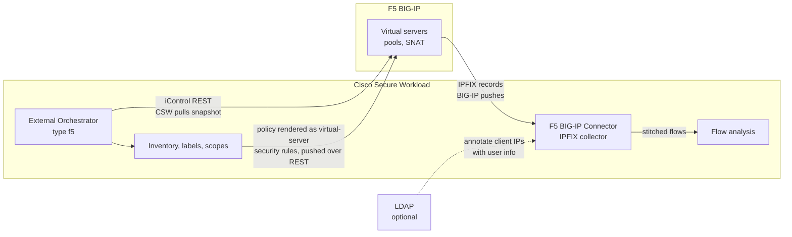
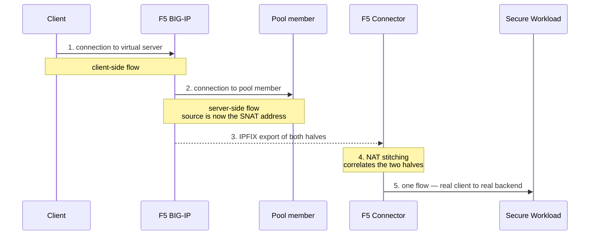
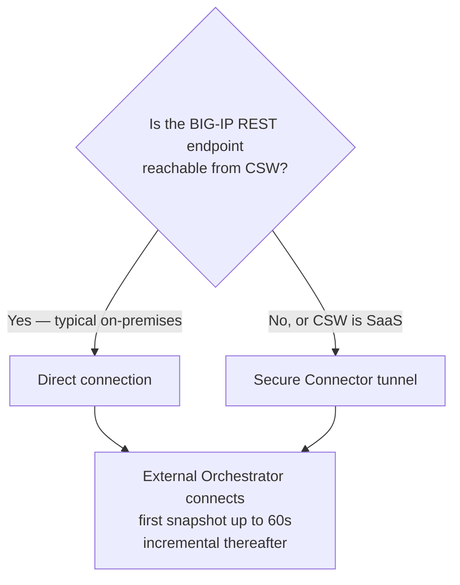

# CSW + F5 BIG-IP integration

How CSW learns about F5 BIG-IP connections and populates flows. Based on the Secure Workload user guides, **3.7 through 4.0**, on-premises and SaaS.

**Full step-by-step:** [CSW-F5-Integration-Guide.md](CSW-F5-Integration-Guide.md) · **Customer handoff checklist:** [docs/CUSTOMER-HANDOFF.md](docs/CUSTOMER-HANDOFF.md)

## The one thing people get wrong

**CSW does not read the BIG-IP session table.** Visibility comes from **IPFIX records the BIG-IP exports**, which CSW then **NAT-stitches**. The BIG-IP pushes; the connector does not poll or scrape. Get this backwards in front of a customer and the follow-up questions will not land.

---

## 1. Two separate integration pieces

They solve different problems and are configured independently.

| Piece | Gives you | Transport | Who initiates |
|---|---|---|---|
| **F5 BIG-IP Connector** | **Flows** — load-balanced flow visibility | IPFIX | **The BIG-IP pushes** |
| **External Orchestrator for F5 BIG-IP** | **Inventory, labels, and policy push** | iControl REST API | **CSW pulls** |

The connector gives you flows. The orchestrator gives you virtual-server inventory, labels, and enforcement.

**The direction of travel is the thing to remember.** Flows arrive because the BIG-IP sends them. Inventory and enforcement happen because CSW reaches out.

---

## 2. How flows get populated — the F5 connector

- The connector is **essentially an IPFIX collector**.
- The BIG-IP ADC is configured to **export IPFIX records to the connector**. The BIG-IP **pushes**; the connector does **not** poll or scrape session tables.
- The connector receives the flow records, **stitches the NATed flows**, and forwards them to Secure Workload for flow analysis.
- **Why stitching matters:** a load balancer splits one logical connection into two — client to virtual server, and BIG-IP to pool member. Without correlation, CSW would see two unrelated flows and the real client would be invisible behind the SNAT address.

  The connector **correlates both halves**, so CSW sees the real client talking to the real backend rather than two unrelated flows.

> **The correlation is only as good as the exported records.** Because stitching is driven by IPFIX rather than by reading a live table on the BIG-IP, the **IPFIX template and field configuration on the F5 side is a real prerequisite**, not a formality. Confirm it before promising visibility.

- If an **LDAP configuration** is supplied to the connector, it can **annotate client IPs with user information** where user data is available.
- **No software agent is required** on the hosts behind the BIG-IP for this visibility.

---

## 3. How CSW "knows about the connection" — session visibility

- Visibility comes from the **exported IPFIX flow records and the NAT stitching**, **not** from reading the BIG-IP session table directly.
- **Both client-side and server-side flows are annotated**, including user details when available.

---

## 4. External Orchestrator for F5 BIG-IP — inventory and policy

- Uses the **BIG-IP REST API** to **snapshot virtual servers**.
- The **first full snapshot can take up to 60 seconds** at the default delta interval; updates after that are **incremental**.
- Generated **labels can be used to build Secure Workload scopes**.
- **Policy enforcement:** CSW translates policies into **security rules assigned to the virtual server** and deploys them **via the BIG-IP REST API**.
- **Connectivity:** the BIG-IP REST API endpoint must be **reachable from CSW**. For **SaaS (TaaS)**, or when the BIG-IP is not directly reachable, configure a **Secure Connector tunnel**.

Imported label keys and the single-address-VIP constraint are in the [README](README.md#imported-labels--quick-reference).

---

## 5. Version notes

- **Connector behaviour** — IPFIX collection, NAT stitching, forwarding — is described **identically across 3.7, 3.8, 3.9, 3.10 and 4.0**, on-premises and SaaS.
- **External orchestrator** details above come from the **3.7 and 3.10** pages. **No 4.0 orchestrator page was found.** Treat 4.0 behaviour there as **likely unchanged but unconfirmed**.

---

## 6. Verify before a deployment

| Item | Why |
|---|---|
| **IPFIX template and field requirements** on the BIG-IP side | Stitching depends on the exported fields |
| **Supported BIG-IP versions** for the release being deployed | Check the [compatibility matrix](https://www.cisco.com/c/m/en_us/products/security/secure-workload-compatibility-matrix.html) |
| **Listening ports and connector placement** — on-prem connector vs SaaS | Determines the IPFIX export target |
| **4.0 external orchestrator documentation** for F5 BIG-IP | Not located; the gap above |

---

## Scope boundary — say this before you are asked

**L3/L4 only.** The stitched flow gives you the real client and the real backend, with ports and protocol. It does **not** give you **L7**. If the same IP and port — 443, typically — serve multiple applications differentiated by **URL or URI**, CSW cannot tell them apart.

This is the first question a load-balancer-heavy customer asks once the stitching lands. State it on the same slide as the mechanism, not as a follow-up.

---

## Sources

Cisco Secure Workload User Guide, **Connectors** and **External Orchestrators** chapters, releases **3.7 through 4.0**.

> Community reference prepared by Cisco Solutions Engineering. Not an official Cisco product document. The [official documentation](https://www.cisco.com/c/en/us/support/security/tetration/series.html) and the compatibility matrix are authoritative.
